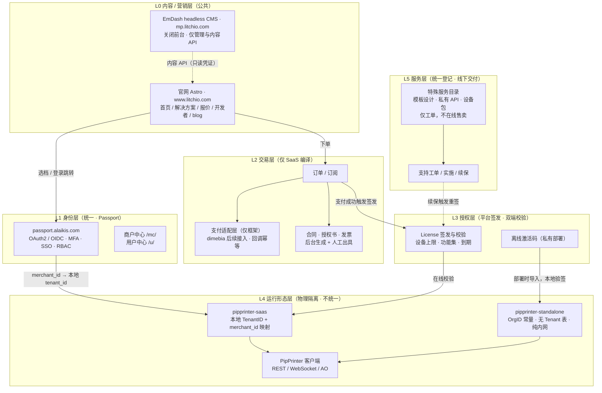
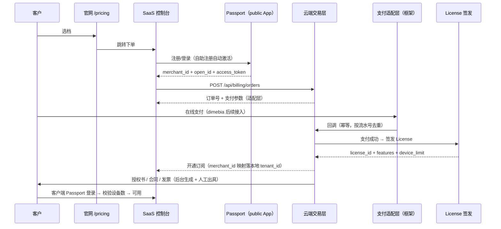
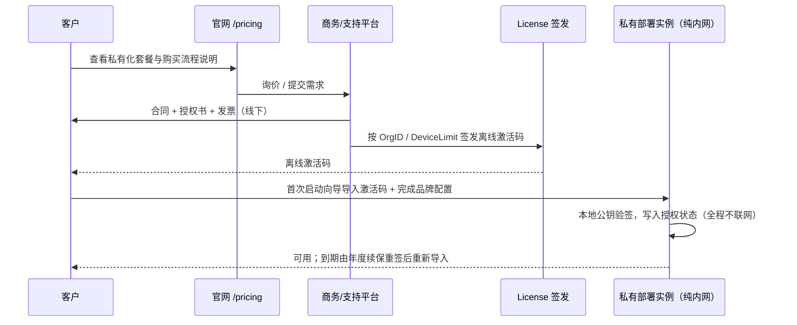

# 荔枝办公 · 统一支持平台设计（评审稿 v0.2）

> 状态：**设计评审稿，不含代码实现**。本文只描述分层、契约与迁移顺序，不修改任何仓库代码。
> 目标：回答「是否在 SaaS 设计一个统一的支持平台，覆盖公共云、私有部署与特殊服务」，并给出可落地的接口契约。
>
> **v0.2 变更（2026-11-15）**：原 §9 的「风险与待拍板」已逐项确认，改为「已确认决策」；补充 EmDash 部署约定（`mp.litchio.com`，关闭前台、仅作 headless CMS）；记录主域与 Cloudflare zone 权限已就绪；记录 Passport 平台侧核实结果（商户 API 子页 404）；「商户 ID 直连 vs 映射」经复询后**定回映射方案**。§1/§2/§3/§4/§5/§6/§7/§8 已按最终决策同步修订。

---

## 0. 事实边界（先说清楚哪些是真实、哪些是建议）

本文严格区分四种标记，避免把设想当成现状：

| 标记 | 含义 |
|---|---|
| **【现状】** | 已在代码或官方文档中核实存在，附文件/路径 |
| **【建议】** | 本设计提出的目标形态，尚未实现，需评审后开发 |
| **【待确认】** | 依赖外部平台或商务决策，文档未给出，不能凭空假设 |
| **【已确认】** | 用户已逐项拍板，作为后续开发基线 |

核实来源：

- Passport 官方页 `https://docs.alaikis.com/docs/hub/devhub/passport/`
- Passport 接入文档 `https://docs.alaikis.com/docs/hub/devhub/passport/api`
- 云端源码 `printer/cloud/`（Gin + GORM，19 个 .go 文件）
- 官网 `printer/site/`（Astro 5 + Cloudflare Workers，8 个页面）
- 客户端 `printer/`（.NET 10 WinForms，REST + 原生 WebSocket + AO 远程）

**已核实的重要否定结论**：Passport 文档中**没有**支付、订单、订阅、License 签发、授权书、合同、发票的任何接口。EmDash 的 commerce 插件（Otta 0.1.0）也**不是**可用的授权购买系统。因此交易能力必须自建于云端，不能挂靠 Passport 或 EmDash。

**v0.2 追加核实结果**（用户选择「我先去核实」后实际执行）：

| 核实项 | 结果 |
|---|---|
| `.../passport/merchant-api.md` | **404「找不到页面」**（文档中心返回） |
| `.../passport/merchant-api`（无后缀） | **404「找不到页面」** |
| 重查 `/passport/api` 是否含 JWKS / token introspect / 公钥端点 | **没有**。API 端点总览里不存在此类端点 |
| 重查 `auth-token: DEV_TOKEN` 语义说明 | **没有**。只在两处示例出现该 header，未解释来源与含义 |
| 商户管理 API 子页准确 href | 抓取内容未给出可访问链接，两个候选 URL 均 404 |

> 结论：§4.6 标 ❓ 的项**仍是真实未知**，不能靠猜补齐，需向 Passport 平台索取（见 §9 剩余待办）。

---

## 1. 现状盘点

### 1.1 已做对的部分：构建期隔离 L1/L2/L3【现状】

| 层 | 实现 | 文件 |
|---|---|---|
| L1 双 model | `saas` tag：`TenantID` + `Tenant` 表；`standalone` tag：`OrgID` 常量、无 Tenant 表。表清单由 `model.All()` 按 tag 返回 | `internal/model/model_saas.go` / `model_standalone.go` |
| L2 形态常量 | `buildinfo.Mode / OrgID / DeviceLimit` 由 `-ldflags -X` 注入，`Resolve()` 不读 env；`main.go` 用 `cfg.Mode = config.Mode(eff.Mode)` 覆盖 env | `internal/buildinfo/info.go`、`cmd/server/main.go:47-53`、`build.sh` |
| L3 repo 封装 | `TemplateRepo/DeviceRepo` 双实现：saas 强制写 `tenant_id`，standalone 强制写 `org_id = buildinfo.OrgID()`，忽略请求传入的 org | `internal/repo/repo_saas.go` / `repo_standalone.go` |
| 路由裁剪 | saas 注册 `/api/admin/tenants`、`/api/admin/billing/summary`；standalone 只有 `/api/admin-single/org` | `cmd/server/main_saas.go` / `main_standalone.go` |
| 设备上限 | `DeviceLimit > 0` 时注册设备返回 429 | `cmd/server/main.go:207-213` |

这套「两套二进制、物理不同表、路由按形态裁剪」正是市面区分 SaaS 与独立部署的主流做法，**不回退**。

### 1.2 现状的真实缺口【现状 → 必须修】

1. **多租户隔离可被伪造（最高优先级）**
   `internal/db/tenant.go:30` 从请求头 `X-Tenant` 直接解析租户 ID：
   ```go
   tenantID := parseTenant(c.GetHeader("X-Tenant"))
   ```
   `internal/repo/repo_saas.go` 拿这个 ID 拼 `WHERE tenant_id = ?`。任何持有 `X-Shared-Key` 的调用方，改一个头就能读写别的租户的模板与设备。**目前 SaaS 的租户边界是「客户端自报」而非「服务端认证」**。

2. **鉴权是单一静态密钥**
   `authGuard()` 仅比对 `X-Shared-Key == PIPPRINTER_SHARED_SECRET`（`main.go:111-121`）。没有用户身份、没有过期、没有 RBAC、没有审计、无法对应到「谁买了什么」。

3. **强制隔离是空壳**
   `db.TenantScopeDB()` 的 `Scopes` 直接 `return tx`（`tenant.go:37-44`），注释写着「交给各 handler 显式 .Where」。隔离依赖每个 handler 自觉，新增接口容易漏。

4. **商业授权无法律文本**
   `cloud/LICENSE-BUSINESS` 第一行即「占位 / 待法务补全」。授权书、合同、发票目前没有可交付的正式文本基础。

5. **「订单」一词存在歧义**
   `cloud/web/app/orders/page.tsx` 是「打印工单 → 选模板 + 纸张 → 路由打印机」的骨架，属于**打印任务分流**，不是商业订单。若直接在此之上做订阅/支付，语义会冲突。

6. **交易实体完全不存在**
   `model.All()` 只有 `Tenant / Template / Device / Job`；`Tenant.Plan` 是 `free/pro/enterprise` 字符串，无计费规则；`/api/admin/billing/summary` 只返回设备数。没有 Order / Subscription / Payment / License / Invoice / Contract / Ticket 任何实体。

7. **私有部署无授权校验**
   `buildinfo.Validate()` 仅在 `PIPPRINTER_LICENSE_CHECK=strict` 时要求 `OrgID != 0`；没有离线激活码、没有到期校验、没有功能开关。

8. **官网报价与后台脱节**
   `site/src/pages/pricing.astro` 已列出 SaaS 分档、私有化套餐与 5 项增值服务（设备接入包、打印量包、模板设计、私有 API 对接、维护续保），但后台无对应实体。用户已明确要求「下载之类都要真实实现而不是占位」——报价后续的购买链路同样不能停在面对用户的说明页。

9. **首次配置缺失**
   `db.Open()` 已做 `AutoMigrate(model.All()...)`（`internal/db/db.go:51`），是自动迁移的基础；但 SQLite 默认 DSN `pipprinter.db` 未建父目录、无迁移版本记录，且**没有首次品牌配置**（用户上一轮提出的需求，尚未实现）。

### 1.3 官网已定的业务边界【现状，设计必须遵守】

- SaaS 端支持**预约打印 + 在线支付**；
- **私有部署不支持在线交易**（资金不入云），且【已确认】运行时**纯内网完全离线**；
- 官网面向用户与开发者两类读者，用户页收敛技术术语、开发者页保留真实接口；
- 【已确认】主域 `https://www.litchio.com` **已完成绑定**，当前 Cloudflare 账户具备该 zone 的操作权限；**本设计不再涉及主域 / zone 处理，不改动 DNS、路由，也不改动仓库内 `wrangler.json`**；
- 【已确认】EmDash 部署于 `mp.litchio.com`，**关闭前台访问，仅作 headless CMS**（详见 §7.4）。

---

## 2. 目标与五条原则

**「统一支持平台」统一的不是运行时，而是账本与身份。** 把身份、授权、订单、服务工单、内容统一到一套可查的账上；运行形态继续物理隔离、各跑各的二进制。

| # | 原则 | 说明 |
|---|---|---|
| P1 | 构建期隔离不回退 | saas / standalone 仍是两套二进制、两套表；统一平台不得引入「运行期形态开关」 |
| P2 | 身份不自建、外部 ID 不直接作主键 | Passport 是唯一身份源；本地不建 user 表、不存密码。【已确认】本地 `Tenant.ID` 保持代理主键，新增 `passport_merchant_id` 唯一索引 + `identity_source` 做映射（§4.4） |
| P3 | 交易物理上只属于 SaaS | 所有 `/api/billing/*` 路由写在 `//go:build saas` 文件里；standalone 二进制里根本不编译这些路由，与「私有部署不支持在线交易」一致 |
| P4 | 私有部署纯内网离线【已确认】 | **运行时不接 Passport、不访问外网**；本地账号 + 离线激活码，到期靠年度续保重签；平台只在「签发 / 续保 / 工单」环节出现 |
| P5 | 说明 ≠ 实现 | 官网只讲清流程（在线支付、授权书、合同、发票），交易逻辑在云端后台 |

> 已确认决策已取代原「待拍板」措辞，作为 P0 起的实现基线，见 §9。

---

## 3. 分层架构



| 层 | 归属系统 | 是否统一 | 是否在线 | 落在哪个构建 |
|---|---|---|---|---|
| L0 内容 | 官网渲染 + EmDash 内容 API | 统一 | 是 | 官网 Worker（EmDash 独立子域） |
| L1 身份 | Passport | **统一** | **仅 SaaS**；私有部署不接 | 外部平台 |
| L2 交易 | 云端交易模块 | 仅 SaaS | 是 | `//go:build saas` |
| L3 授权 | 平台签发 + 双端校验 | 统一账本 | SaaS 在线 / 私有纯离线 | 两者都有校验，签发只在平台 |
| L4 运行 | 云端 + 客户端 | **不统一** | 各自 | saas / standalone 两套 |
| L5 服务 | 支持平台工单 | 统一登记 | 线下 | 平台侧 |

> 关键：**统一发生在 L1/L3/L5，隔离保持在 L4**。这既回答了「要不要统一平台」，也守住了之前做的防篡改隔离。
> 【已确认】图里**没有** Passport → standalone 的连线：私有部署纯内网离线，身份走本地账号。`mp.litchio.com` 只向官网 Worker 提供内容 API，不面向访客。

---

## 4. Passport 集成契约【现状：以下端点均来自官方文档】

### 4.1 平台入口

| 用途 | 域名 |
|---|---|
| 管理后台 | `https://authhub.alaikis.com/adm/` |
| 商户中心 | `https://id.alaikis.com/mc/` |
| 用户中心 | `https://account.alaikis.com/u/` |
| API 服务 | `https://passport.alaikis.com` |
| OAuth 授权页 | `https://auth.alaikis.com` |

### 4.2 与本项目相关的真实端点

| 场景 | 方法 | 路径 | 关键参数 / 响应 |
|---|---|---|---|
| **桌面简化登录**（客户端推荐） | POST | `/api/v1/open/user/desktop/login` | 入 `client_id, account, password`；出 `access_token, refresh_token, sso_session_id, open_id, user_id, merchant_id, expires_in=3600, refresh_token_expires_in=2592000` |
| Token 刷新 | POST | `/api/v1/open/user/desktop/refresh` | 入 `refresh_token`；30 天滚动续期 |
| 标准密码登录 | POST | `/api/v1/open/user/login` | `client_id, account, password` |
| 商户注册 | POST | `/customer/auth/register` | 自动建 merchant + internal app + client + admin |
| 用户注册 | POST | `/api/v1/open/user/register` | 需先 `/api/v1/open/user/verify/send` 取验证码 |
| OAuth 授权 | GET | `/oauth/v2/authorize` | `client_id, response_type=code, redirect_url, scope, state` |
| 换取 Token | POST | `/api/v1/token` | `code`（文档示例带 `auth-token: DEV_TOKEN`） |
| 撤销 Token | POST | `/api/v1/revoke` | — |
| SSO 校验 | POST | `/api/v1/open/user/sso/session/validate` | 头 `X-SSO-Token` |
| SSO 登出 | POST | `/api/v1/open/user/sso/logout` | 头 `X-SSO-Token` |
| 用户信息 | POST | `/api/v1/user/profile/detail` | 文档示例 `auth-token: DEV_TOKEN` + `uid` |
| Agent Token | POST | `/api/v1/open/agent/token` / `/exchange` | 智能体跨应用访问 |

其他公开端点：`/api/v1/open/user/email/login`、`/phone/login`、`/reset/send`、`/reset`、`/password/change`、`/verify/send`、`/api/v1/open/agent/apps`(GET)、`/api/v1/open/agent/token/revoke`、`/oidc/federate/{id}`、`/oidc/callback/{id}`。错误码：`200/400/401/403/406/429/500`。

### 4.3 数据模型（文档原文）

```
merchant（商户/租户）
  ├─ app（type: public / private / internal）→ client（client_id / client_secret）
  ├─ user（管理员与终端用户共用）
  │    ├─ app_user（绑定，state: 0=待激活 / 1=已激活；open_id = app_user.id）
  │    └─ user_role
  ├─ role / permission / role_permission
  └─ developer
```

- `client_id` 是公开标识，可硬编码进桌面客户端；`client_secret` **绝不落地客户端**。
- `internal` app 注册商户时自动创建、不可删改；首个用户自动获 admin 角色。
- `public` app 自助注册自动激活；`private` app 需管理员邀请并手动激活。
- 安全：bcrypt、JWT RS256、密码历史、强制改密、登录失败锁定、审计日志。协议：OAuth2(RFC 6749) / OIDC 1.0 / JWT(7519) / TOTP(6238) / Token Exchange(8693)。

**【已确认】本产品 App 类型：统一 `public`** —— SaaS 客户自助注册、自动激活（`app_user.state=1`），零门槛试用；集团/私有客户不通过 Passport 开通（私有部署纯内网、本地账号）。因此不需要 `private` App 与邀请激活流程。`app_user.state` 校验仍保留（防御性）。

### 4.4 字段映射【已确认：改回映射方案】

> 决策过程：初稿推荐「映射」，用户曾选「`merchant_id` 直接作主键」，复询权衡后 **2026-11-15 定回映射**。

| Passport 字段 | 云端落点 | 说明 |
|---|---|---|
| `merchant_id` (number) | `Tenant.PassportMerchantID`（**唯一索引**）+ `Tenant.IdentitySource`（默认 `passport`） | 外部标识只作查找键，**不作本地主键** |
| `Tenant.ID`（uint 自增，代理主键） | 解析出的 `tenant_id`，业务表继续用它 | 【已确认】`Template/Device/Job` 的 `tenant_id` 与 repo 全部**零改动** |
| `open_id` (= app_user.id) | `Identity.Subject`，仅用于审计与操作人记录 | 本地不建 user 表 |
| `app_user.state` | 放行判断：`state=1` 才允许调用 | `public` app 下注册即激活，仍做校验 |
| `access_token` (1h) | 中间件校验，不落库 | refresh 由客户端持有 |
| `client_id` | 硬编码在 PipPrinter 客户端 / 控制台服务端配置 | 需向平台申请 public App + Client |
| `sso_session_id` | 控制台跨应用登录 | 官网 → 控制台跳转用 |

**为什么映射更科学（决策依据）**：

| 维度 | 映射 | 直连作主键 |
|---|---|---|
| 主键语义 | 本地领域身份由自己分配，外部 ID 只是集成契约 | 外部系统分配的 ID 成了自己的身份 |
| 租户生命周期 | 本地可有「待开通/试用/正常/欠费停用/注销」状态机，不动 Passport | 停用/注销都得改外部商户，两者绑死 |
| 1:1 假设 | 不假设；可支持一个商户多租户（集团按园区分账）、未来多身份源 | 强制 1:1，报价页「集团·多园区」会顶到天花板 |
| 换 IdP / 灾备 | 加 `identity_source` 即可并存；重建库、测试环境自由分配 ID | 全库主键与外键值都要换，需平台配合 |
| 现有代码改动 | 只加字段 + 唯一索引 | 改主键生成、回填所有历史 `tenant_id`，且 Passport 的 `number` 类型/范围文档未保证 |
| 索引 / 枚举 | 本地 `uint` 紧凑，外部 ID 不暴露在业务外键里 | 外部 ID 扩散到每张业务表，易被扫 |

Passport 文档「一个用户可绑定多个商户」与官网「1 个租户 / 集团多园区」都说明**本地租户 ≠ Passport 商户**。直连只在「单一身份源永不换、严格 1:1、无独立租户生命周期、无计费分账」的极简原型里占优，本项目四条都不满足。

**实现要点【建议，P0 处理】**：

1. `model_saas.go` 的 `Tenant` 增加 `PassportMerchantID`（唯一索引）与 `IdentitySource`；`ID` 保留自增 `uint`。
2. `POST /api/admin/tenants` 改为按 `passport_merchant_id` **幂等 upsert**，由「Passport 商户注册成功」事件触发，禁止前端自造租户。
3. 中间件 `tenantStore.ResolveByMerchant(merchant_id)` 解析本地 `tenant_id`；**带缓存**（内存/KV），或登录成功后由本地签发短期会话 token（内含 `tenant_id` + roles），后续请求零查库。
4. 若未来接入第二个身份源，`IdentitySource` + `ExternalID` 组成联合唯一索引即可，无需改业务表。

### 4.5 身份中间件替换契约【建议：本设计的第一优先级改动】

```go
// 【现状】可伪造 —— internal/db/tenant.go:30
tenantID := parseTenant(c.GetHeader("X-Tenant"))

// 【建议】由服务端认证结果决定租户，不从请求头取
ident, err := passport.Verify(c)                  // 校验 Passport token
if err != nil { c.AbortWithStatusJSON(401, ...); return }
if ident.AppUserState != 1 { c.AbortWithStatusJSON(403, "not activated"); return }
tenantID, ok := tenantStore.ResolveByMerchant(ident.MerchantID) // 映射 + 缓存
if !ok { c.AbortWithStatusJSON(403, "tenant not provisioned"); return }
c.Set(ctxKeyTenant, Resolved{
    TenantID: tenantID,
    Subject:  ident.OpenID,
    Roles:    ident.Roles,
})
```

配套改动：
- `Resolved` 增加 `Subject / Roles`，`repo` 接口的 `org uint` 保持由中间件注入（**禁止**从请求体或请求头取）。
- 删除 `X-Tenant` 解析；`TenantScopeDB` 从空壳改为 GORM 全局 Scope 强制注入租户条件，避免新 handler 漏写。
- `X-Shared-Key` 降级为「服务间内部调用」凭证，不再作为面向用户的鉴权。
- 私有部署（standalone）不执行上述中间件：本地账号 + 离线激活码，编译期 `OrgID` 注入，见 §5.3。

### 4.6 Passport 侧核实结果（2026-11-15）

用户选择「我先去核实」，实际执行结果如下。**标 ❓ 的仍是真实未知，不假设答案**：

| # | 事项 | 状态 |
|---|---|---|
| 1 | JWKS / 公钥端点 / token introspect | ❓ 官方文档**没有**。无法本地做 JWT RS256 验签。过渡方案：用 `POST /api/v1/open/user/sso/session/validate` 或服务端用户信息接口校验 + 缓存，接受外部依赖与延迟 |
| 2 | `auth-token: DEV_TOKEN` 语义 | ❓ 文档只在 `/api/v1/token` 与 `/api/v1/user/profile/detail` 示例出现，未解释来源；直接影响控制台能否走标准授权码流程 |
| 3 | App 类型 | ✅【已确认】统一 `public`；剩 `client_id` 申请（文档写「联系平台管理员获取」）与 `redirect_url` 报备域名 |
| 4 | 商户管理 API 能否按 `merchant_id` 查状态 | ❓ `merchant-api.md` 与 `/merchant-api` **均 404「找不到页面」**，需向平台索取正确地址或接口说明 |
| 5 | 429 限流阈值 / 406 重试策略 | ❓ 文档只给错误码表，无阈值 |
| 6 | 私有部署内网方案 | ✅【已确认】不需要。私有部署纯内网完全离线，不接 Passport，无需内网镜像或离线校验方案 |

**责任**：第 1/2/4/5 项由 AI 继续向平台核实；在拿到结论前，P0 的身份校验实现需保留可替换的 `passport.Verify` 适配层，不把过渡方案写死。

---

## 5. 新平台接口契约【建议：全部尚未实现】

> 下列路径是设计目标，不是现有接口。标注 `saas` 的路由必须写在 `//go:build saas` 文件内，`standalone` 二进制中不编译。

### 5.1 公共（两形态都有）

| 方法 | 路径 | 用途 | 鉴权 |
|---|---|---|---|
| GET | `/health` | 【现状】探活，已返回 `mode/org/dev_limit` | 无 |
| GET | `/api/setup/status` | 【建议】返回 `{initialized, has_brand, has_license}`，未初始化时业务接口返回 409 引导初始化 | 无（仅本机/首启） |
| POST | `/api/setup/brand` | 【建议】首次品牌配置：名称、Logo、主色、页脚、联系信息 | 首启令牌 |
| GET | `/api/license/status` | 【建议】授权主体、计划、设备上限、到期、功能集 | 已认证 |
| GET/PUT/DELETE | `/api/templates/*` | 【现状】模板 CRUD，走 repo 封装 | 已认证 |
| GET/POST | `/api/devices*` | 【现状】设备列表 / 注册 / 心跳 | 已认证 |

**首次启动门控**：`db.Open()` 已做 `AutoMigrate`（`internal/db/db.go:51`）；【建议】加固为：SQLite 自动创建 DSN 父目录、幂等可重复执行、增加迁移版本表；应用启动后若 `has_brand=false`，除 `/api/setup/*` 与 `/health` 外一律返回 409，控制台跳转首次配置向导。这与用户提出的「应用初始使用时需要完成品牌配置」直接对应。

### 5.2 SaaS 专属（`//go:build saas`）

| 方法 | 路径 | 用途 |
|---|---|---|
| POST | `/api/admin/tenants` | 【现状】创建租户；【建议·已确认】改为按 `passport_merchant_id` 幂等 upsert，本地 ID 自增，禁止前端自造租户 |
| GET | `/api/admin/tenants` | 【现状】租户列表 |
| GET | `/api/admin/billing/summary` | 【现状】仅返回设备数；【建议】扩展为订阅量、打印量、账单周期 |
| POST | `/api/billing/orders` | 【建议】按 `/pricing` 档位创建订单（**不含特殊服务在线加购**） |
| GET | `/api/billing/orders/:id` | 【建议】订单状态查询 |
| POST | `/api/billing/payments/callback` | 【建议·已确认】**只留支付适配层框架**：`PaymentGateway` 接口 + 回调幂等（按流水号去重）；后续接 dimebia，当前不接具体通道 |
| GET | `/api/billing/subscriptions` | 【建议】当前订阅、续费、升降档 |
| GET | `/api/billing/invoices` | 【建议·已确认】后台生成单据 + 人工出具，提供记录与 PDF 下载；电子签 / 开票系统后置 |
| POST | `/api/billing/contracts` | 【建议·已确认】后台生成授权书 / 合同草稿 + 人工出具，不做全自动电子签 |
| GET/POST | `/api/support/tickets` | 【建议·已确认】支持工单，是特殊服务与实施的**唯一**入口（不在线售卖） |

### 5.3 私有部署专属（`//go:build standalone`）

| 方法 | 路径 | 用途 |
|---|---|---|
| GET | `/api/admin-single/org` | 【现状】返回编译期 `OrgID/DeviceLimit/Mode` |
| POST | `/api/admin-single/license/import` | 【建议】导入离线激活码并本地验签（**不联网**） |
| GET | `/api/admin-single/license` | 【建议】本地授权状态（不联网、无心跳） |

**明确不注册**：任何 `/api/billing/*`、`/api/support/*`（在线）、支付、发票、合同路由，以及任何 Passport 相关路由。私有部署二进制里连路由表都不存在，用户改参数也变不出交易能力——这是 P3 原则的物理保证。

### 5.4 License 数据结构【建议：格式待定，不写死实现】

```text
License {
  license_id, mode(saas|standalone),
  merchant_id（外部标识）| org_id（私有部署，编译期）,
  plan, device_limit, features[],
  issued_at, expires_at,
  signature                        # 平台私钥签发，双端内置公钥验签
}
OfflineActivationCode              # Base64(License + signature)，私有部署导入用
```

- 签名方案【建议】沿用 Passport 的 **RS256 非对称签名**思路：平台持私钥签发，客户端/私有部署内置公钥验签，离线可验；**具体算法与码格式待定**，不在本文档编造。
- 【已确认】私有部署**无 License 心跳、无远程续期、无在线到期校验**；到期由年度维护续保触发人工重签并重新导入离线码。
- 【建议】设备上限来源：SaaS 由 License 动态给出；standalone 仍以 `buildinfo.DeviceLimit` 为硬兜底，并与离线码取**较小值**，防止授权被放大。
- 【建议】`features[]` 承接能力开关（预约打印、在线支付、模板数量、私有 API 等）；【已确认】特殊服务通过**工单触发重签**变更 features，不提供在线加购。

### 5.5 「订单」命名去歧义【建议】

| 现有 | 建议改名 | 含义 |
|---|---|---|
| `model.Job` + `web/app/orders` | `print-jobs` / 打印工单 | 一次打印任务：模板 + 数据 + 纸张 + 目标设备 |
| 新增 `Order` / `Subscription` / `Invoice` | `billing/orders` | 商业订单：谁买了什么、付了多少、开了什么票 |

---

## 6. 三种形态的统一与边界矩阵

| 维度 | 公共云 SaaS | 私有部署（独立部署） | 特殊服务 |
|---|---|---|---|
| 身份 | Passport（统一 public App，必须在线） | **本地账号 + 离线激活码，纯内网，不接 Passport** | 平台统一登记 |
| 商户/组织 | **本地 `Tenant.ID` 自增 + `passport_merchant_id` 映射** | `buildinfo.OrgID`（编译期） | 挂到同一租户/组织 |
| 交易 | 在线订单 + 订阅 | **无在线交易** | **仅工单线下，不在线扣款、不在线加购** |
| 在线支付 | dimebia（后续接入，**当前仅留适配层框架**） | 不支持 | 不支持 |
| 授权方式 | 在线签发 + 在线/本地校验 | 离线激活码导入，**无心跳 / 无远程续期** | 工单触发 `features[]` 重签 |
| 授权书 / 合同 / 发票 | **后台生成 + 人工出具** | 商务线下出具 | 随合同 |
| 设备上限 | License 动态 | `DeviceLimit` 编译期硬兜底 | 工单登记（设备包） |
| 预约打印 | 支持 | 不支持 | — |
| 升级 | 平台统一发版 | 客户自行部署 + 维护续保 | 实施工单 |
| 数据 | 平台托管，租户隔离 | 客户自有库，不出园区 | — |
| 支持渠道 | 工单 + 客户成功 | 年度维护 + 工单 | 专属实施 |
| 内容来源 | 官网 Worker 消费 `mp.litchio.com` 内容 API | 与内容层无关 | — |

> 与官网 `solutions.astro` 已写的「SaaS 支持预约打印 + 在线支付 / 私有部署不支持在线交易」完全一致，矩阵只是把它落到系统层。
> **dimebia** 为用户录入名称，按原样保留；准确拼写、主体资质与接口文档【待确认】，当前页面不写死该品牌。

---

## 7. 购买与授权链路

### 7.1 SaaS 在线链路【建议】



### 7.2 私有部署离线链路【建议】



### 7.3 页面该说明什么（回答「是否说明操作流程」）

**应该说明，但只说明、不实现。**【建议】在 `/pricing` 增加「购买与交付流程」一节，文案要点：

1. 选择档位 → 2. 用 Passport 账户自助注册/登录 → 3. 在线支付（**页面只写「在线支付」，不写死具体支付品牌**；后台留对接框架，dimebia 后续接入） → 4. 系统自动开通并签发授权 → 5. 授权书、合同与发票由商务在后台生成并人工出具，可在控制台查看下载。
2. 私有部署明确写：**不提供在线支付**，走商务合同 + 离线授权码 + 首次配置向导；运行时可完全内网离线。
3. 增值服务（模板设计、私有 API 对接、实施、维护续保）**仅走服务工单**，不放进在线购物车、不提供在线加购。
4. 所有流程链接指向 SaaS 控制台；官网前端不承载任何交易逻辑。

> 前置条件：`LICENSE-BUSINESS` 需先由法务定稿，否则「授权书 / 合同」的页面承诺没有可交付文本。

### 7.4 EmDash 部署约定【已确认：headless CMS，关闭前台】

| 项 | 决策 |
|---|---|
| 域名 | **`mp.litchio.com`**（独立子域） |
| 前台访问 | **关闭**。EmDash 不向访客提供任何公开页面（无 `/blog` 渲染、无公开主题、无 SEO 输出） |
| 角色 | 仅作 **headless CMS**：内容编辑后台 + 内容 API |
| 内容呈现 | 由官网 `www.litchio.com` 的 Astro 页面自行渲染（`/blog` 列表与详情页归官网，canonical 归 www 主域） |
| 对外暴露 | 仅管理后台（需认证）与只读内容 API；其余路径拒绝公网访问 |
| 凭证 | 官网 Worker 持**只读内容凭证**拉取，凭证放 Worker 环境变量 / secret，**绝不进前端代码** |
| DNS / zone | 【已确认】主域已绑定，当前 Cloudflare 账户具备 zone 权限；`mp` 子域解析属部署阶段操作，本文档不改动 DNS 与 `wrangler.json` |

**内容链路【建议】**：EmDash 编辑 → 官网通过只读 API 拉取文章 → 官网输出 `/blog` 列表与详情页。推荐**构建期拉取并静态生成**（Astro 预渲染），好处是访客请求不依赖 CMS 可用性、`mp` 子域可完全不对公网开放、天然无运行时延迟；若需要「改完即见」，再补 Webhook 触发官网重新构建，或在 Worker 运行时拉取 + KV 缓存（【待确认】按运营频率选）。

**用途边界**：

| 用途 | 是否用 EmDash |
|---|---|
| 场景文章 / 最佳实践 / 更新日志 / 接入指南 | **用**，但仅作为内容源；页面由官网渲染 |
| 报价说明、购买流程说明 | 可用，但 `/pricing` 已用 Astro 静态页承载，无需迁移 |
| 授权购买、订单、支付、License、合同发票 | **不用**。commerce 插件（Otta 0.1.0）与 x402 均不是授权购买系统，交易必须落在云端 |

---

## 8. 迁移路线（按依赖排序，评审后再动代码）

| 阶段 | 内容 | 验收标准 |
|---|---|---|
| **P0 安全与法务前置** | ① 用 Passport 身份中间件替换 `X-Tenant`（§4.5）；② `TenantScopeDB` 改为全局强制 Scope；③ `Tenant` 加 `passport_merchant_id` 唯一索引 + `identity_source`，按映射幂等开通租户（§4.4）；④ `LICENSE-BUSINESS` 法务定稿；⑤ 申请统一 public App/Client，继续核实 §4.6 的 ❓ 项 | 带伪造 `X-Tenant` 的请求无法读写他人租户数据；同一 merchant 重复开通只产生 1 个本地租户；`go vet -tags saas/standalone ./...` 双通过 |
| **P1 授权与首次配置** | ① License 签发/校验 + 离线激活码（无心跳、无远程续期）；② `/api/setup/*` 首次品牌配置 + 409 门控；③ 启动自动迁移加固（SQLite 父目录、迁移版本表）；④ 设备上限与 License 联动 | 未配置品牌的实例除 setup 外全部 409；私有部署断网可激活、可打印；超限仍 429；私有二进制无外网请求 |
| **P2 交易层** | ① Order/Subscription/Payment/Invoice/Contract 实体（saas tag）；② **支付适配层框架**（`PaymentGateway` 接口 + 回调幂等），dimebia 后续接入；③ 后台生成单据 + 人工出具；④ 控制台 `orders` → `print-jobs` 改名并新增 `billing/orders`；⑤ 官网购买流程说明上线 | 用 mock 网关可走通「下单→回调→开通→设备可注册」；standalone 产物中 grep 不到 `/api/billing` 与 `/api/support`；官网无交易逻辑 |
| **P3 内容与服务** | ① EmDash headless CMS 部署到 `mp.litchio.com`、关闭前台；② 官网 `/blog` 消费内容 API；③ 支持工单与特殊服务目录（仅线下）；④ 报价页档位与后台 Plan 对账 | `mp.litchio.com` 前台路径不可访问、内容 API 需凭证；官网文章正常渲染且 canonical 归 www；后台改价与官网一致 |

**不建议一次性上「大平台」**：先把 P0 的越权堵上、把身份接进来，P1 让授权与首次配置闭环，这两步做完，统一支持平台就有了身份与授权两根支柱；P2/P3 是往上面挂业务。

---

## 9. 已确认决策（2026-11-15）

原「风险与待拍板」已逐项单选/录入确认。以下为**实现基线**：

| # | 决策项 | 结论 | 影响章节 |
|---|---|---|---|
| 1 | 私有部署联网策略 | **纯内网完全离线**；无 License 心跳、无远程续期，到期靠年度续保重签 | §2 P4、§3、§5.3、§6、§7.2 |
| 2 | Passport 平台侧未确认项 | **由 AI 继续核实**；已执行：商户 API 子页 404、JWKS/DEV_TOKEN 仍未知 | §0、§4.6 |
| 3 | Passport App 类型 | **统一 `public`**（自助注册、自动激活） | §4.3、§7.1 |
| 4 | 商户 ID 方案 | **映射**（初稿推荐 → 曾选直连 → 复询后定回映射）：本地 `Tenant.ID` 自增 + `passport_merchant_id` 唯一索引 + `identity_source`，业务表零改动 | §2 P2、§4.4、§4.5、§5.2、§6 |
| 5 | 支付通道 | **后续使用 dimebia 作为支付平台，当前只留对接框架**（`PaymentGateway` + 回调幂等），不接具体通道、官网不写死品牌 | §5.2、§6、§7.1、§7.3、§8 P2 |
| 6 | 授权书 / 合同 / 发票 | **后台生成 + 人工出具**；电子签与开票系统后置，`LICENSE-BUSINESS` 需法务定稿 | §5.2、§6、§7.1、§7.3 |
| 7 | 特殊服务 | **仅工单线下**，不在线加购、不在线扣款 | §3、§5.2、§5.4、§6、§7.3 |
| 8 | EmDash 部署 | 独立子域 **`mp.litchio.com`，关闭前台访问，仅作 headless CMS**；官网渲染内容 | §1.3、§3、§6、§7.4、§8 P3 |
| 9 | 主域 / zone | **已绑定，当前 Cloudflare 账户具备 zone 权限；不做任何处理**（不动 DNS、`wrangler.json`、路由） | §1.3、§7.4 |

### 剩余待办（非决策，属事实核实或外部依赖）

1. 向 Passport 平台索取：JWKS / introspect 端点、`DEV_TOKEN` 语义、商户管理 API 正确地址、429 阈值；并申请 public App 的 `client_id` 与报备 `redirect_url`。
2. `LICENSE-BUSINESS` 法务定稿，明确授权书 / 合同 / 发票的出具主体。
3. dimebia 的准确拼写、主体资质与接口文档（名称按用户录入原样记录）。
4. `mp.litchio.com` 的 DNS 解析与 EmDash 后台认证配置（部署阶段操作，文档不代做）。
5. 内容注入方式（构建期静态生成 vs Worker 运行时 + KV 缓存）按运营频率在 P3 定。

---

## 10. 附录：本文引用的真实文件与来源

| 主题 | 文件 / 来源 |
|---|---|
| 构建期形态 | `cloud/internal/buildinfo/info.go`、`tag_saas.go`、`tag_standalone.go`、`cloud/build.sh` |
| 双 model | `cloud/internal/model/model_saas.go`、`model_standalone.go` |
| repo 封装 | `cloud/internal/repo/repo.go`、`repo_saas.go`、`repo_standalone.go` |
| 路由与鉴权 | `cloud/cmd/server/main.go`、`main_saas.go`、`main_standalone.go` |
| 租户解析缺口 | `cloud/internal/db/tenant.go:23-44` |
| 自动迁移现状 | `cloud/internal/db/db.go:51` |
| 商业授权占位 | `cloud/LICENSE-BUSINESS` |
| 打印工单歧义 | `cloud/web/app/orders/page.tsx` |
| 官网报价与边界 | `site/src/pages/pricing.astro`、`solutions.astro` |
| Passport 事实来源 | `docs.alaikis.com/docs/hub/devhub/passport/`、`/passport/api` |
| Passport 核实结果 | `.../passport/merchant-api.md` 与 `.../passport/merchant-api` 均 404（2026-11-15 实测） |
| 决策来源 | 用户逐项单选 / 录入确认（2026-11-15），见 §9 |
